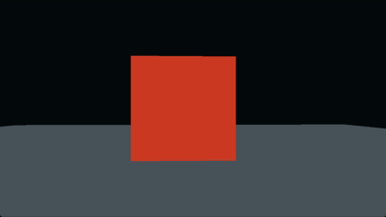

# Industrial Frontier

**A Native C++ Industrial Mining and Automation Simulation**

Industrial Frontier is a 3D mining, exploration, and industrial automation game built from the ground up in native C++.

The goal is to create an explorable world where players can discover resources, develop mining operations, construct industrial facilities, and build increasingly complex production systems.

## Gameplay Preview



*Early development footage — free-fly camera prototype.*

## Project Overview

Industrial Frontier aims to combine open-world exploration with industrial simulation and resource management.

Planned gameplay systems include:

- Procedurally generated voxel terrain
- Mining and resource extraction
- Underground exploration and excavation
- Ore processing and refining
- Conveyor belts and material transportation
- Industrial machinery and production chains
- Electrical generation and power distribution
- Storage and logistics management
- Research and technological progression
- Equipment maintenance and machine failures
- Save and load functionality

## Technology

| Component | Technology |
|---|---|
| Language | C++20 |
| Build System | CMake |
| Windowing and Input | SDL3 |
| Graphics | OpenGL 3.3 |
| IDE | Visual Studio Code |
| Compiler | MSVC |

## Development Status

**Early development — systems and features are actively being built.**

| System | Status |
|---|---|
| Application foundation | Implemented |
| SDL3 window and event loop | Implemented |
| OpenGL rendering foundation | Implemented |
| Free-fly camera | Implemented |
| Procedural terrain | Planned |
| Mining system | Planned |
| Resource processing | Planned |
| Industrial automation | Planned |
| Power systems | Planned |
| Save/load | Planned |

## Project Goals

Industrial Frontier is being developed with a focus on:

- A world that can be explored and physically modified.
- Meaningful resource discovery and extraction.
- Industrial systems that interact with one another.
- Large-scale production and infrastructure.
- A modular foundation that can grow over time.

## Building

The project uses CMake and requires a compatible C++20 compiler, SDL3, and OpenGL development support.

On Windows, configure and build using:

```powershell
cmake -S . -B build
cmake --build build --config Debug