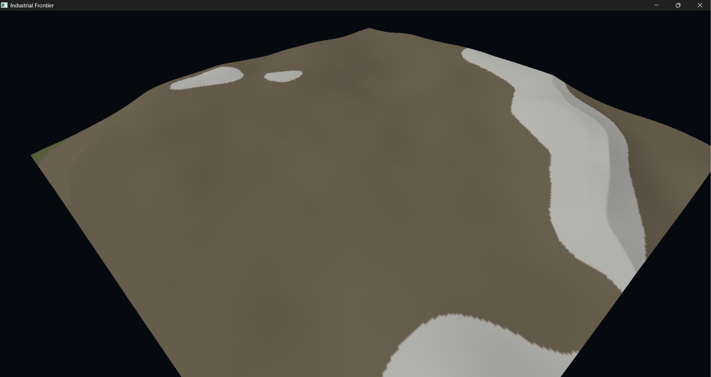

# Industrial Frontier

**A Native C++ Mining, Exploration, and Industrial Automation Simulation**

**Build. Mine. Process. Automate. Expand.**

Industrial Frontier is a 3D mining, exploration, and industrial automation game being developed by **CyberTrace Studios** using native C++20, SDL3, OpenGL, and CMake.

The long-term goal is to create an explorable, physically modifiable world where players discover resources, establish mining operations, construct industrial facilities, and connect increasingly complex production systems.

The current **Showcase v5** focuses on procedural terrain, interactive excavation, underground movement, and the technical foundation for future mining and automation gameplay. The industrial systems described in the roadmap are **planned**, not yet playable.

## Gameplay Preview




*Early development footage and screenshots. These previews show earlier terrain and camera prototypes, not necessarily the latest Showcase v5 visuals.*

## Showcase v5 — Below the Surface

Showcase v5 is a major transition from a heightmap-only landscape to **volumetric, diggable 3D terrain**.

### What's implemented

- **Procedural landscapes:** Mountains, hills, valleys, canyons, and traversable terrain generated from a world seed.
- **Volumetric voxel density:** Represents solid ground and empty space beneath the surface.
- **Smooth voxel meshing:** Marching Tetrahedra produces terrain floors, walls, ceilings, and excavation surfaces.
- **Interactive digging:** Aim at terrain and left-click to excavate rounded holes and connected tunnels.
- **Chunk-based terrain streaming:** Generates terrain in the background and updates affected chunks after excavation.
- **Underground player collision:** Supports landing on excavated floors and interacting with underground walls and ceilings.
- **First-person exploration:** WASD movement, mouse look, sprinting, and jumping.
- **Main menu and introduction:** Existing menu, cinematic camera, and introduction flow remain part of the game.
- **Windows and Linux builds:** The project builds natively on Windows and Linux, with automated Linux builds through GitHub Actions.

### Showcase v5 development stages

| Stage | Feature | Status |
| --- | --- | --- |
| 1 | Voxel density system | Implemented |
| 2 | Smooth 3D voxel meshing | Implemented |
| 3 | Voxel terrain rendering | Implemented |
| 4 | Interactive terrain digging | Implemented |
| 4 hotfix | Excavation surface visibility | Fixed |
| 5 | Underground player collision | Implemented; further testing and refinement planned |
| 6 | Excavation persistence | Planned |
| 7 | Terrain streaming optimization | Planned |
| 8 | Rare procedural deep caves | Planned |
| 9 | Gameplay HUD and centered crosshair | Planned |

## Gameplay Vision

Industrial Frontier is designed to grow from hands-on exploration and mining into a larger industrial simulation. Planned features include:

- Discoverable ores, minerals, and other natural resources.
- Resource collection, storage, and inventory management.
- Ore crushing, smelting, refining, and processing.
- Conveyor belts and automated material transport.
- Industrial machinery and interconnected production chains.
- Electrical generation and power distribution.
- Facility construction and infrastructure expansion.
- Research, upgrades, and technological progression.
- Machine maintenance, equipment failures, and operational management.
- Persistent world saves and loading.
- Rare deep cave systems accessed through navigable, sloping passages into larger chambers.

**These are development goals.** Many are not included in Showcase v5.

## Technology

| Component | Technology |
| --- | --- |
| Language | C++20 |
| Build system | CMake (3.25 or newer) |
| Windowing, events, and input | SDL3 |
| Graphics | OpenGL 3.3 Core Profile |
| Terrain | Procedural noise, volumetric density, Marching Tetrahedra |
| World generation | Asynchronous, chunk-based streaming |
| Development environment | Visual Studio Code / Windows 11 |
| Windows compiler | MSVC |
| Linux compiler | GCC or Clang |
| Linux continuous integration | GitHub Actions (Ubuntu 24.04) |

SDL3 is fetched during CMake configuration through the project's `FetchContent` setup.

## Controls

| Input | Action |
| --- | --- |
| `W` / `A` / `S` / `D` | Move |
| Mouse | Look around |
| Left mouse button | Dig terrain (during gameplay) |
| `Shift` | Sprint |
| `Space` | Jump |
| `Escape` | Pause / resume |

A centered crosshair and expanded gameplay HUD are planned for Stage 9.

## Downloads and Builds

Prebuilt packages are produced separately for Windows and Linux:

- **Windows x64:** `IndustrialFrontier-v5-Windows-x64.zip`
- **Linux x64:** `IndustrialFrontier-v5-Linux-x64.tar.gz`

Check the [GitHub Releases page](https://github.com/DeFragedGaming/Industrial-Frontier/releases) for published release files and the [GitHub Actions page](https://github.com/DeFragedGaming/Industrial-Frontier/actions) for automated Linux build artifacts. GitHub Actions downloads may contain the Linux `.tar.gz` inside an artifact ZIP.

### Build on Windows

Requirements: Windows 10/11, a C++20-capable MSVC toolchain, CMake, and OpenGL development support.

From the project root in PowerShell:

```powershell
cmake -S . -B build
cmake --build build --config Release
.\build\Release\IndustrialFrontier.exe
```

The build copies required assets and the SDL3 runtime alongside the executable.

### Build on Linux

Requirements: a C++20 compiler, CMake, Ninja, OpenGL development libraries, and SDL3's Linux build dependencies. The [Linux GitHub Actions workflow](.github/workflows/linux-build.yml) contains the dependency list used for the automated Ubuntu 24.04 build.

From the project root:

```bash
cmake -S . -B build-linux -G Ninja -DCMAKE_BUILD_TYPE=Release
cmake --build build-linux --parallel
./build-linux/IndustrialFrontier
```

To run the packaged Linux build:

```bash
tar -xzf IndustrialFrontier-v5-Linux-x64.tar.gz
cd IndustrialFrontier-v5-Linux-x64
./run.sh
```

The included `run.sh` sets the library search path for the bundled SDL3 runtime and launches the game with the correct working directory. On Ubuntu, the OpenGL runtime package `libopengl0` may be necessary if it is not already installed.

**Linux note:** The Linux executable has been launched and gameplay-tested under Ubuntu 24.04 through WSL2. Performance under WSL2 software rendering may differ substantially from a native Linux desktop with GPU acceleration. Broader Linux distribution testing is ongoing.

## Known Limitations

Industrial Frontier is an early development showcase. Current limitations include:

- Excavation edits do **not yet persist** between game sessions.
- Rapid movement may briefly expose unloaded terrain while chunks stream in.
- Terrain-generation and mesh-rebuilding performance still need optimization.
- Procedural natural cave systems and the gameplay crosshair are planned, not yet implemented.
- Mining resources, ore processing, automation, power systems, and full industrial gameplay remain future work.

## Project Goals

- A seamless-feeling world that can be explored and physically modified.
- Accessible slopes and navigable underground spaces rather than inaccessible vertical surfaces everywhere.
- Meaningful resource discovery, extraction, and processing.
- Industrial systems that influence one another through logistics and production.
- A modular native C++ foundation that can grow over time.
- Continued support for both Windows and Linux.

## Development and Source Code

Industrial Frontier is developed by **CyberTrace Studios**. The repository contains the game's evolving source code, assets, and build configuration.

Follow development, inspect the code, and track future updates here:

**[Industrial Frontier on GitHub](https://github.com/DeFragedGaming/Industrial-Frontier)**

*Industrial Frontier is a work in progress. Features, performance, visuals, and systems may change during development.*
