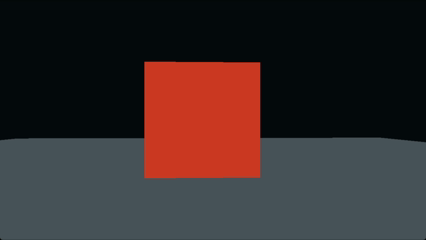
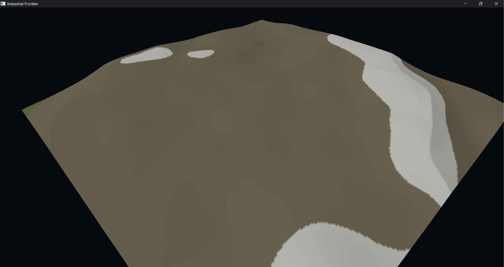

<div align="center">

# INDUSTRIAL FRONTIER

### Build. Mine. Process. Automate. Expand.

**A procedural 3D mining, survival, and industrial simulation built with a custom C++ engine.**

[](https://en.cppreference.com/w/cpp/20)
[](https://www.libsdl.org/)
[](https://www.opengl.org/)
[](https://cmake.org/)

**Current milestone: Stage 10H-2 — Primitive Machinery, Rivers & Mineral Separation**

[Play on itch.io](https://cybertrace.itch.io/industrial-frontier) · [Releases](https://github.com/DeFragedGaming/Industrial-Frontier/releases) · [Linux Builds](https://github.com/DeFragedGaming/Industrial-Frontier/actions) · [Source Code](https://github.com/DeFragedGaming/Industrial-Frontier)

*Developed by CyberTrace Studios*

</div>

---

## About the game

**Industrial Frontier** is a work-in-progress mining and industrial simulation where the world is more than a backdrop. You can explore procedurally generated landscapes, excavate the ground, gather materials, process real minerals, craft tools, and build the beginnings of a mining operation.

The aim is to start with primitive equipment and work toward increasingly capable machinery. Before there are conveyors and automated factories, there are stone tools, charcoal, clay furnaces, hand cranks, and rivers that can help separate valuable minerals from waste.

Instead of using Unity or Unreal Engine, the project runs on a **custom, purpose-built C++20 engine**, with **SDL3** for windowing and input, **OpenGL 3.3** for 3D rendering, and **CMake** for cross-platform builds.

> **Development status:** This is an early playable showcase, not a finished survival or automation game. The features under *Implemented* below exist in the current development code; they are still being tested and refined.

## Gameplay previews





*These are archival previews from earlier builds. The current game has additional mining, crafting, structures, rivers, and ore-processing machinery not shown here.*

## Implemented systems

| System | Current capabilities |
| :-- | :-- |
| **Procedural world** | Seed-based mountains, valleys, hills, forests, geology, and streamed terrain chunks |
| **Volumetric terrain** | Smooth 3D voxel meshing, terrain excavation, tunnels, underground surfaces, and collision |
| **Rivers and lakes** | Winding river networks, connected tributaries, side channels, carved banks, lakes, and animated directional current |
| **Mining and geology** | Real mineral identities, varying ore grades and compositions, tool-based mining requirements, and resource collection |
| **Survival crafting** | Harvesting, primitive tools, charcoal, campfires, tool durability, and a category-based crafting interface |
| **Metallurgy** | Clay furnace, compatible early metal smelting, reusable multi-ingot casting, and copper tools |
| **Ore-processing machinery** | Hand-cranked edge-runner crusher, hand-powered grinding mill, and flow-driven river sluice |
| **Inventory and storage** | Hotbar, draggable inventory items, weight limits, starter storage, placeable wooden chests, and stack transfers |
| **Construction** | Snapping log foundations, walls, doorframes, window walls, roof pieces, and supports with previews and collision |
| **Persistence and guides** | World and gameplay save/load, stored machine progress, and an in-game Field Guide |

### Mining with real minerals

Mineral deposits aren't simply labeled “copper ore” or “iron ore.” The game's geology and processing systems distinguish minerals such as **Malachite, Azurite, Cuprite, Chalcopyrite, Bornite, Cassiterite, Cerussite, and Hematite**. Composition and material properties matter, and tools restrict what can be mined at different progression tiers.

### Primitive machinery: Stage 10H

The first physical processing machines are now part of the world:

1. **Edge-runner ore crusher:** Load up to **30 kg** of raw ore and operate a rolling stone wheel by hand to produce crushed ore.
2. **Hand-powered ore mill:** Grind up to **25 kg** of crushed ore into ground material.
3. **River sluice:** Place a wooden sluice in suitable moving water and process up to **20 kg** of ground ore into **concentrate and tailings**.

These machines use crafted placement kits, procedural 3D geometry, player interaction, collision, and persistent state. Ore batches keep their mineral information as they move through processing.

Water has directional flow data that affects sluice operation. **It is not yet a full fluid-physics simulation**; visible currents are animated with shaders.

### Procedural, not preassembled

Industrial Frontier's terrain, geology, river networks, forests, and many of its machines and structures are generated through code. The world is deterministic from its seed, while excavation and construction allow players to change it. Interface icons and other artwork are handled separately; not every visual asset is procedurally generated.

## Development roadmap

| Milestone | Focus | Status |
| :-- | :-- | :-- |
| **Showcase v5** | Volumetric terrain, excavation, underground collision, world streaming | Implemented foundations; ongoing refinement |
| **Stage 10A–10E** | Geological systems, mining, mineral data, early processing and Field Guide | Implemented |
| **Stage 10F** | Primitive tools, harvesting, inventory, crafting, campfires and charcoal | Implemented |
| **Stage 10G / Part One** | Clay furnace, casting, copper equipment, storage, and log construction | Implemented |
| **Stage 10H-1** | Primitive edge-runner ore crusher | Implemented |
| **Stage 10H-2 / Part Two** | Hand-powered mill, sluice, river networks, tributaries, lakes, and flowing-water visuals | Implemented; in-game tuning ongoing |
| **Stage 10H-3 / Part Three** | Ore roasting, improved furnaces, forging, alloys, bronze and iron progression | **Planned** |
| **Later Stage 10H** | Mechanical power, conveyors, transport, and connected automation | **Planned** |
| **Stage 10I** | Integration, optimization, stability, and further polish | **Planned** |

Longer-term goals include expanded underground exploration, improved mineral recovery, more demanding mining equipment, industrial-scale facilities, power generation, machine maintenance, and automated production lines.

## Controls

Controls vary by interaction and the currently open menu. The **Field Guide (`G`)** provides in-game help.

| Input | Action |
| :-- | :-- |
| `W` / `A` / `S` / `D` | Move |
| Mouse | Look around / aim |
| `Shift` | Sprint |
| `Space` | Jump |
| Left mouse button | Excavation / context-sensitive interaction |
| `1`–`8` | Select hotbar slot |
| `I` | Inventory |
| `B` | Storage or targeted wooden chest |
| `C` | Crafting menu |
| `P` | Ore-processing menu |
| `G` | Field Guide |
| `F` | Start / confirm placement preview with an equipped kit |
| `Q` / `R` | Rotate placement preview |
| `V` | Cycle compatible ore batches while targeting a machine |
| `E` | Gather, interact, or load a targeted machine |
| Hold `R` | Operate a loaded hand-cranked crusher or mill |
| `T` | Collect processed machine output or cooled ingots |
| `X` | Dismantle a suitable empty structure or machine |
| `F3` | Toggle additional HUD details |
| `F5` / `F9` | Open save / load interface |
| `Escape` | Pause, back, or close the current interface |

In the crafting menu, use **Left/Right** for categories, **Up/Down** for recipes, **Page Up/Down** to browse, and **Enter** to craft. Mouse selection is also supported.

## Technology

| Area | Stack |
| :-- | :-- |
| Language | C++20 |
| Custom engine | Purpose-built game loop, renderer, terrain, movement, UI, gameplay, and persistence |
| Windowing and input | SDL3 |
| UI text | SDL3_ttf |
| 3D graphics | OpenGL 3.3 Core Profile and GLSL shaders |
| Terrain | Seeded noise, volumetric density fields, and Marching Tetrahedra |
| Streaming | Asynchronous chunk generation and mesh uploads |
| Build system | CMake 3.25+; Visual Studio/MSVC on Windows; GCC or Clang on Linux |
| Linux CI | GitHub Actions on Ubuntu 24.04 |

SDL3 and related dependencies are obtained through the project's CMake configuration. Initial configuration may require an internet connection.

## Download development builds

Check [**GitHub Releases**](https://github.com/DeFragedGaming/Industrial-Frontier/releases) for published versions and [**GitHub Actions**](https://github.com/DeFragedGaming/Industrial-Frontier/actions) for recent Linux build artifacts.

- **Windows x64:** Distributed as a ZIP containing `IndustrialFrontier.exe`, DLLs, and `assets/`. Extract it before running the game.
- **Linux x64:** The permanent CI workflow produces an artifact named `IndustrialFrontier-Linux-x64`, containing `IndustrialFrontier-Linux-x64.tar.gz` and a checksum. GitHub may wrap the archive in an additional artifact ZIP.

Development packages are not guaranteed to be available for every commit, and Linux compatibility outside the CI environment is still being evaluated.

## Build from source

### Windows

**Requirements:** Windows 10/11, MSVC with C++20 support, CMake 3.25+, and OpenGL support.

Run in PowerShell at the repository root:

```powershell
cmake -S . -B build
cmake --build build --config Release
ctest --test-dir build -C Release --output-on-failure
.\build\Release\IndustrialFrontier.exe
```

### Linux

**Requirements:** A C++20 compiler, CMake 3.25+, Ninja, OpenGL development libraries, and SDL3's platform dependencies. The [Linux CI workflow](.github/workflows/linux-build.yml) lists the packages used on Ubuntu 24.04.

```bash
cmake -S . -B build-linux -G Ninja -DCMAKE_BUILD_TYPE=Release
cmake --build build-linux --parallel 4
ctest --test-dir build-linux --output-on-failure
./build-linux/IndustrialFrontier
```

To generate the reusable Linux distribution archive:

```bash
bash tools/linux/package.sh build-linux dist
```

To extract and launch the packaged Linux build:

```bash
cd ~/Downloads
tar -xzf IndustrialFrontier-Linux-x64.tar.gz
cd IndustrialFrontier-Linux-x64
chmod +x run.sh IndustrialFrontier
./run.sh
```

The packaged launcher sets the library path for its bundled SDL3 runtime. Other system libraries, GPU drivers, and OpenGL support are still required.

## Automated builds and testing

The [Linux workflow](.github/workflows/linux-build.yml) is designed to be **stage-independent**. It builds and tests new commits to `main` and pull requests, then packages a consistent `IndustrialFrontier-Linux-x64` archive. Future gameplay milestones should not need a renamed workflow or packaging script.

Automated regression tests cover multiple systems, including geology, inventories, ore processing, machinery, placement, collision, and saved state. **A configured workflow does not guarantee every commit passes**; consult [Actions](https://github.com/DeFragedGaming/Industrial-Frontier/actions) for the latest result.

## Current limitations

- The game is in active development; visuals, controls, progression, and saves may change.
- Rivers use generated surfaces and flow fields rather than fully simulated water; swimming, fluid dynamics, and advanced erosion are not implemented.
- River generation may alter the terrain layout of existing seeded worlds. **Back up save files before testing world-generation updates.**
- Terrain streaming and mesh rebuilding need continued performance work, especially on integrated graphics.
- Underground cave generation and traversal still need further refinement and broader playtesting.
- High-tier metallurgy, powered machinery, conveyors, electricity, and complete industrial automation are future development work.
- Windows and Linux builds should be tested independently; behavior may differ across drivers and hardware.

## Contributing and following development

Industrial Frontier is a solo development project by **CyberTrace Studios**. Source code, build configurations, tests, and development history are available in this repository.

- [Download and follow on itch.io](https://cybertrace.itch.io/industrial-frontier)
- [Repository](https://github.com/DeFragedGaming/Industrial-Frontier)
- [Releases](https://github.com/DeFragedGaming/Industrial-Frontier/releases)
- [Builds and tests](https://github.com/DeFragedGaming/Industrial-Frontier/actions)

Bug reports and reproducible build failures are helpful. When reporting an issue, include your operating system, steps to reproduce, and relevant logs.

---

<div align="center">

**Build. Mine. Process. Automate. Expand.**

*Industrial Frontier is a work in progress. Everything here is subject to further testing and change.*

**CyberTrace Studios**

</div>
